# BLUEPRINT SISTEM
# IoT Lab Management System (ILMS)

**Versi Dokumen:** 1.0
**Disusun sebagai:** Dokumen arsitektur & rencana pengembangan (portfolio-grade)
**Prinsip pengembangan:** MVP → Functional System → Portfolio Enhancement → IoT Integration

---

## DAFTAR ISI

1. Project Overview
2. Problem Statement
3. Goals
4. Scope
5. User Roles & Permission
6. Functional Requirements
7. Non-Functional Requirements
8. System Architecture
9. Module Architecture
10. Technology Stack
11. Database Architecture
12. ERD
13. UML
14. REST API Design
15. PWA Architecture
16. IoT Architecture
17. Security Architecture
18. Project Structure
19. Development Roadmap
20. Testing Strategy
21. Deployment Architecture
22. GitHub Documentation
23. Portfolio Development Strategy
24. Future Development

---

## 1. PROJECT OVERVIEW

**IoT Lab Management System (ILMS)** adalah aplikasi web untuk mengelola inventaris komponen elektronik/IoT di laboratorium kampus — mencakup pendataan komponen, proses peminjaman-pengembalian, histori pergerakan stok, serta (pada fase lanjutan) pendaftaran dan monitoring perangkat IoT berbasis ESP32.

Proyek ini memiliki dua tujuan sekaligus:

| Tujuan | Penjelasan |
|---|---|
| **Operasional** | Menjawab kebutuhan nyata laboratorium kampus yang sering kehilangan jejak komponen, tidak tahu siapa meminjam apa, dan tidak punya histori kerusakan/stok. |
| **Portfolio** | Menjadi bukti kompetensi mahasiswa dalam Web Development, Database Design, REST API, PWA, dan IoT Integration — lengkap dan konsisten dari desain sampai kode. |

Sistem dibangun bertahap (MVP dulu, IoT belakangan) agar tetap **selesai** dan **layak dipakai**, bukan sekadar rencana besar yang tidak pernah tuntas.

---

## 2. PROBLEM STATEMENT

Laboratorium kampus pada umumnya mengelola inventaris komponen secara manual (buku catatan/spreadsheet), yang menimbulkan masalah:

1. **Tidak ada visibilitas stok real-time** — sulit tahu berapa unit ESP32 yang tersedia saat ini.
2. **Peminjaman tidak terlacak** — tidak jelas siapa memegang komponen apa dan kapan harus dikembalikan.
3. **Tidak ada histori perubahan stok** — ketika stok berubah, tidak ada catatan mengapa (dipinjam? rusak? masuk baru?).
4. **Kondisi komponen tidak terdokumentasi** — komponen rusak sering tetap tercatat "tersedia".
5. **Tidak ada data terpusat perangkat IoT** yang dimiliki lab, termasuk status aktif/tidaknya.
6. **Proses administratif manual** menyita waktu asisten lab/admin.

ILMS menjawab semua ini dengan sistem tersentralisasi berbasis web yang juga terbuka untuk integrasi perangkat IoT nyata.

---

## 3. GOALS

Sistem harus mampu:

1. Mengelola data komponen dan perangkat IoT secara terstruktur.
2. Mengelola kategori komponen.
3. Menampilkan stok & kondisi komponen secara real-time dari database.
4. Mengelola proses peminjaman dan pengembalian komponen end-to-end.
5. Mencatat histori penggunaan/perubahan stok komponen.
6. Mengelola data pengguna dan hak akses berbasis role.
7. Menyediakan dashboard administrator yang informatif.
8. Menyediakan laporan inventaris dan transaksi peminjaman (termasuk export).
9. Mengelola perangkat IoT terdaftar di laboratorium.
10. Memungkinkan integrasi ESP32 melalui REST API (registrasi, heartbeat, data sensor).
11. Menampilkan status perangkat IoT (online/offline) dan waktu terakhir aktif.
12. Dibangun modular agar dapat dikembangkan menjadi sistem monitoring IoT penuh tanpa merombak modul inti.

---

## 4. SCOPE

### 4.1 Batasan Proyek

Agar tidak overengineering untuk proyek mahasiswa, scope dibagi bertingkat dan **wajib dikerjakan berurutan**:

```
TAHAP 1 (MVP)          : Website + Database + Inventory + Borrowing
TAHAP 2 (Portfolio+)   : Dashboard, Reports, Notification, PWA
TAHAP 3 (IoT Dasar)    : IoT Device Management + ESP32 Integration (REST API)
TAHAP 4 (IoT Lanjutan) : IoT Monitoring (sensor data, chart, historical)
```

### 4.2 In-Scope
- Manajemen komponen, kategori, stok, kondisi.
- Alur peminjaman-pengembalian dengan approval admin.
- Histori pergerakan stok (audit trail).
- Autentikasi & role-based access control (Admin, Mahasiswa/User).
- Dashboard statistik.
- Laporan inventaris/peminjaman/kerusakan/IoT + export CSV/PDF.
- Registrasi & heartbeat perangkat IoT (ESP32) via REST API.
- Penyimpanan & visualisasi data sensor dasar (fase lanjut).
- PWA: installable, offline-capable untuk halaman non-transaksional.
- Notifikasi in-app & browser (gratis, tanpa layanan berbayar).

### 4.3 Out-of-Scope (untuk versi ini)
- Multi-tenant (multi-kampus/multi-lab dalam satu instance).
- Payment/billing.
- Mobile native app (cukup PWA).
- Real-time streaming video/CCTV.
- Machine learning/predictive maintenance (masuk *Future Development*).

---

## 5. USER ROLES & PERMISSION

| Role | Deskripsi | Hak Akses Utama |
|---|---|---|
| **Admin** | Pengelola lab (dosen/laboran/asisten) | CRUD komponen & kategori; approve/reject/kelola semua peminjaman; kelola user & role; kelola perangkat IoT; lihat semua laporan & dashboard; kelola notifikasi sistem; lihat audit log |
| **Mahasiswa/User** | Peminjam komponen | Lihat katalog komponen (read-only); ajukan peminjaman; lihat riwayat peminjaman miliknya; kelola profil sendiri; terima notifikasi terkait peminjamannya |
| **IoT Device (ESP32)** | Bukan user manusia, tapi *actor* sistem | Registrasi diri via API key; kirim heartbeat; kirim data sensor; **tidak** memiliki akses ke UI web |

### Matriks Permission (ringkas)

| Fitur | Admin | User | Device |
|---|:---:|:---:|:---:|
| CRUD Component/Category | ✅ | ❌ (read-only) | ❌ |
| Ajukan peminjaman | ✅ (opsional, jarang) | ✅ | ❌ |
| Approve/Reject peminjaman | ✅ | ❌ | ❌ |
| Lihat semua transaksi | ✅ | ❌ (hanya milik sendiri) | ❌ |
| Kelola user | ✅ | ❌ (profil sendiri saja) | ❌ |
| Kelola device IoT | ✅ | ❌ | ❌ (hanya via API terbatas) |
| Kirim data sensor | ❌ | ❌ | ✅ (via API key) |
| Lihat dashboard admin | ✅ | ❌ | ❌ |
| Lihat laporan | ✅ | Sebagian (riwayat pribadi) | ❌ |

Autentikasi manusia menggunakan **session/JWT**, sedangkan device menggunakan **API key/device token** terpisah (bukan akun user).

---

## 6. FUNCTIONAL REQUIREMENTS

| Kode | Requirement |
|---|---|
| FR-01 | Sistem menyediakan login/logout untuk Admin dan User |
| FR-02 | Sistem menyediakan manajemen profil & ganti password |
| FR-03 | Admin dapat CRUD data komponen lengkap dengan foto |
| FR-04 | Admin dapat CRUD kategori komponen |
| FR-05 | Sistem menampilkan stok tersedia vs stok total secara real-time |
| FR-06 | User dapat mengajukan peminjaman komponen dengan jumlah tertentu |
| FR-07 | Admin dapat approve/reject pengajuan peminjaman |
| FR-08 | Sistem otomatis mengurangi stok tersedia saat peminjaman disetujui |
| FR-09 | User/Admin dapat memproses pengembalian dan mencatat kondisi barang |
| FR-10 | Sistem mencatat setiap perubahan stok ke tabel histori |
| FR-11 | Sistem menyediakan dashboard dengan statistik utama |
| FR-12 | Sistem menyediakan laporan (inventaris, peminjaman, kerusakan, IoT) dengan export CSV/PDF |
| FR-13 | Admin dapat mendaftarkan & mengelola perangkat IoT |
| FR-14 | ESP32 dapat registrasi & mengirim heartbeat via REST API |
| FR-15 | Sistem menampilkan status device (online/offline) berdasarkan last seen |
| FR-16 | ESP32 dapat mengirim data sensor ke API, tersimpan dengan timestamp |
| FR-17 | Sistem menampilkan data sensor terkini & historis (chart) |
| FR-18 | Sistem mengirim notifikasi in-app untuk event penting (approve, jatuh tempo, stok rendah, device offline, dsb.) |
| FR-19 | Sistem menyediakan pencarian, filter, sorting, pagination pada seluruh data master |
| FR-20 | Aplikasi dapat di-install sebagai PWA dan tetap dapat menampilkan data cache saat offline |

---

## 7. NON-FUNCTIONAL REQUIREMENTS

| Kategori | Requirement |
|---|---|
| **Performance** | Response time API < 300ms untuk operasi CRUD sederhana pada skala data lab (ribuan baris) |
| **Scalability** | Struktur modular; database ternormalisasi agar mudah menambah modul monitoring tanpa migrasi besar |
| **Usability** | UI mobile-first, responsif, sederhana untuk mahasiswa non-teknis |
| **Reliability** | Semua state transition (peminjaman, stok) atomik — tidak boleh ada stok "hilang" akibat race condition |
| **Security** | Password hashing (bcrypt/argon2), RBAC, proteksi SQL Injection/XSS/CSRF, API key untuk device |
| **Maintainability** | Kode terstruktur layered (controller-service-repository), penamaan konsisten, dokumentasi lengkap |
| **Portability** | Dapat dijalankan lokal (XAMPP/Node/Docker) tanpa dependency berbayar |
| **Availability** | Untuk skala lab kampus, target uptime "best effort" (bukan enterprise SLA) |
| **Cost** | 100% dapat dijalankan dengan tools gratis/open-source; deployment gratis (tier gratis hosting) |

---

## 8. SYSTEM ARCHITECTURE

ILMS menggunakan **layered architecture** yang umum di enterprise namun disederhanakan agar dapat dipahami dan dikerjakan mahasiswa.

### 8.1 Lapisan Arsitektur

| Layer | Fungsi | Contoh Komponen |
|---|---|---|
| **Client Layer** | Perangkat pengguna (browser desktop/mobile) yang mengakses PWA | Browser, HP, laptop |
| **Presentation Layer** | UI/UX aplikasi, rendering komponen, routing frontend | React/Vue components, halaman dashboard |
| **API Layer** | Menerima request HTTP, validasi input, routing ke business logic | Express/NestJS routes, middleware auth |
| **Business Logic Layer** | Aturan bisnis: alur peminjaman, perhitungan stok, status device | Service layer (LoanService, StockService, DeviceService) |
| **Data Access Layer** | Abstraksi query ke database | ORM (Prisma/Sequelize) atau Query Builder |
| **Database Layer** | Penyimpanan data persisten | PostgreSQL/MySQL |
| **IoT Device Layer** | Perangkat fisik yang berkomunikasi ke backend | ESP32 + sensor/aktuator |

### 8.2 Diagram Arsitektur (Konsep)

```
┌───────────────────────────────────────────────────────────┐
│                        CLIENT LAYER                        │
│         Browser Desktop / Mobile (PWA installed)            │
└───────────────────────────┬──────────────────────────────┘
                             │ HTTPS
┌───────────────────────────▼──────────────────────────────┐
│                    PRESENTATION LAYER                       │
│      React/Vue SPA + Service Worker (cache, offline)        │
└───────────────────────────┬──────────────────────────────┘
                             │ REST/JSON (fetch/axios)
┌───────────────────────────▼──────────────────────────────┐
│                        API LAYER                             │
│   Express/NestJS Routes + Middleware (Auth, Validation)      │
└───────────────────────────┬──────────────────────────────┘
                             │
┌───────────────────────────▼──────────────────────────────┐
│                  BUSINESS LOGIC LAYER                        │
│  AuthService, ComponentService, LoanService, DeviceService   │
└───────────────────────────┬──────────────────────────────┘
                             │
┌───────────────────────────▼──────────────────────────────┐
│                   DATA ACCESS LAYER                          │
│              ORM: Prisma / Sequelize / TypeORM                │
└───────────────────────────┬──────────────────────────────┘
                             │
┌───────────────────────────▼──────────────────────────────┐
│                     DATABASE LAYER                            │
│                  PostgreSQL / MySQL                            │
└────────────────────────────────────────────────────────────┘

                (Jalur terpisah untuk perangkat IoT)

┌───────────────────┐   WiFi   ┌───────────────────┐
│   ESP32 + Sensor    ├─────────▶  REST API (Device  │
│  (HC-SR04, DHT22..) │  HTTP    │   Endpoints)        │
└───────────────────┘          └─────────┬──────────┘
                                          │
                                          ▼
                                 Business Logic Layer
                                          │
                                          ▼
                                    Database Layer
```

**Prinsip kunci:** ESP32 tidak pernah mengakses database secara langsung — selalu melalui REST API, sama seperti web client. Ini menjaga satu titik kontrol keamanan dan validasi data.

---

## 9. MODULE ARCHITECTURE

```
ILMS
├── 1. Authentication & User Management
├── 2. Dashboard
├── 3. Inventory / Component Management
├── 4. Category Management
├── 5. Borrowing & Return Management
├── 6. Inventory Transaction / Stock History
├── 7. IoT Device Management
├── 8. IoT Monitoring   (dibangun modular, opsional/plug-in)
├── 9. Search, Filter & Reporting
└── 10. Notification
```

Setiap modul di atas dipetakan 1:1 ke domain service di backend (mis. modul 5 → `LoanService`), sehingga tidak ada modul "yatim" yang tidak punya representasi di kode maupun database. Modul 8 (IoT Monitoring) sengaja dipisah dari modul 7 (Device Management) agar tabel `sensor_readings` dapat ditambahkan tanpa mengubah skema `devices`/`components` yang sudah stabil.

### 9.1 Penjelasan Modul & Fitur

**Modul 1 — Authentication & User Management**
Login, logout, registrasi (opsional, biasanya akun dibuat admin), manajemen user, RBAC (Admin/User), profil, ganti password, session/token (JWT) management.

**Modul 2 — Dashboard**
Statistik: total komponen, total stok, tersedia, dipinjam, rusak, total transaksi, jumlah user, device online/offline, log aktivitas terbaru. Ditampilkan dengan card statistik, tabel ringkas, chart (bar/pie), dan activity log.

**Modul 3 — Inventory/Component Management**
CRUD komponen lengkap (nama, kode inventaris, kategori, deskripsi, stok, tersedia, kondisi, lokasi, tanggal beli, harga, foto, status) dengan search/filter/sort/pagination dan halaman detail.

**Modul 4 — Category Management**
CRUD kategori (Microcontroller, Sensor, Actuator, Motor, Display, Communication Module, Power, Passive Component, Other) + jumlah komponen per kategori.

**Modul 5 — Borrowing & Return Management**
Alur: User pilih komponen → tentukan jumlah → ajukan → Admin approve/reject → jika approve, stok tersedia berkurang → status "Borrowed" → User kembalikan → Admin cek kondisi → transaksi selesai ("Returned").

**Modul 6 — Inventory Transaction/Stock History**
Audit trail setiap perubahan stok (masuk, keluar, dipinjam, dikembalikan, rusak, diperbaiki, penyesuaian) — mencatat timestamp, user, jenis transaksi, jumlah, stok sebelum/sesudah, referensi transaksi, catatan.

**Modul 7 — IoT Device Management**
CRUD data perangkat IoT (device id, nama, tipe, ESP32 ID, IP, firmware version, lokasi, status, last seen, tanggal registrasi). Menyediakan endpoint registrasi & heartbeat.

**Modul 8 — IoT Monitoring**
Menyimpan & menampilkan data sensor (suhu, kelembapan, jarak, soil moisture, water level) dengan timestamp; current value, historical data, chart, status device, last update.

**Modul 9 — Search, Filter & Reporting**
Pencarian/filter lintas entitas (komponen, kategori, user, transaksi, device, sensor data); laporan inventaris, peminjaman, kerusakan, IoT; export CSV/PDF.

**Modul 10 — Notification**
In-app & browser notification untuk: peminjaman disetujui/ditolak, jatuh tempo, terlambat, stok rendah, device offline/online kembali. Tanpa layanan pihak ketiga berbayar (cukup Web Push API gratis + tabel `notifications`).

---

## 10. TECHNOLOGY STACK

Kriteria pemilihan: **gratis, mudah dipelajari, portfolio-friendly, mendukung PWA & REST API & ESP32, mudah dijalankan lokal & di-deploy gratis.**

### 10.1 Frontend

| Kebutuhan | Rekomendasi | Alasan | Alternatif |
|---|---|---|---|
| Framework | **React (Vite)** | Ekosistem besar, banyak referensi belajar, mendukung PWA plugin resmi | Vue 3 (lebih mudah untuk pemula) |
| CSS/UI | **Tailwind CSS + shadcn/ui** | Cepat membangun UI konsisten tanpa menulis CSS manual | Bootstrap 5 (lebih klasik/mudah) |
| State Management | **React Context + TanStack Query** | Cukup untuk skala aplikasi lab; TanStack Query menangani cache & sinkronisasi data API | Redux Toolkit (jika state kompleks) |
| Chart Library | **Recharts** atau **Chart.js** | Ringan, dokumentasi jelas, cocok untuk dashboard & sensor chart | ApexCharts |
| PWA | **vite-plugin-pwa** (Workbox) | Otomatis generate manifest & service worker dari konfigurasi Vite | Manual Workbox config |

### 10.2 Backend

| Kebutuhan | Rekomendasi | Alasan | Alternatif |
|---|---|---|---|
| Bahasa | **Node.js (TypeScript)** | Satu bahasa dengan frontend (JS/TS), banyak tutorial, cocok REST API | PHP (Laravel) jika mahasiswa lebih familiar |
| Framework | **Express.js** (atau NestJS untuk struktur lebih enterprise) | Ringan, fleksibel, banyak middleware siap pakai | NestJS (struktur modular ala Angular, lebih "enterprise") |
| REST API | Native Express routing + Zod untuk validasi schema | Sederhana dan type-safe | Fastify |
| Authentication | **JWT (jsonwebtoken)** + bcrypt untuk hashing | Stateless, cocok untuk API yang juga diakses ESP32 | Session-based (express-session) untuk web-only |
| Validation | **Zod** | Type inference otomatis ke TypeScript | Joi / express-validator |

### 10.3 Database

| Kebutuhan | Rekomendasi | Alasan | Alternatif |
|---|---|---|---|
| DBMS | **PostgreSQL** | Gratis, robust, mendukung JSONB (berguna untuk data sensor fleksibel), banyak tier gratis di cloud | MySQL/MariaDB (lebih familiar bagi mahasiswa) |
| ORM | **Prisma** | Migration & seeding bawaan, type-safe query, schema mudah dibaca | Sequelize / TypeORM |
| Migration | Prisma Migrate | Terintegrasi dengan ORM, versi terkontrol | Knex migrations |
| Seeding | Prisma Seed script | Data awal komponen (ESP32, DHT22, dst.) otomatis ter-load | Custom SQL seed script |

### 10.4 IoT

| Kebutuhan | Rekomendasi | Alasan | Alternatif |
|---|---|---|---|
| Hardware | **ESP32 DevKit** | WiFi bawaan, murah, komunitas besar | ESP8266 (lebih terbatas) |
| Environment | **Arduino IDE** atau **PlatformIO (VS Code)** | Arduino IDE mudah untuk pemula; PlatformIO lebih profesional | — |
| Protokol Komunikasi | **HTTP REST (JSON)** ke backend | Sederhana, tidak butuh broker tambahan, cocok skala lab | MQTT (jika butuh real-time & efisiensi lebih tinggi — masuk *Future Development*) |
| Library ESP32 | `HTTPClient.h`, `ArduinoJson.h`, `WiFi.h` | Library resmi/umum untuk request HTTP dan parsing JSON | PubSubClient (jika pakai MQTT) |

### 10.5 Development Tools

| Tools | Fungsi |
|---|---|
| **Git & GitHub** | Version control & portfolio hosting kode |
| **VS Code** | Editor utama (+ ekstensi ESLint, Prettier, Prisma, Thunder Client) |
| **Docker (opsional)** | Menyeragamkan environment DB lokal |
| **Postman/Thunder Client** | Testing REST API manual |
| **XAMPP/Local Postgres** | Alternatif environment DB tanpa Docker |

---

## 11. DATABASE ARCHITECTURE

### 11.1 Prinsip Desain
- Normalisasi hingga **3NF** untuk tabel master (users, components, categories, devices) agar tidak ada redundansi data.
- Tabel histori (`component_stock_history`, `sensor_readings`) bersifat **append-only** (insert-only, tidak pernah update/delete) demi integritas audit trail.
- Semua foreign key menggunakan `ON DELETE RESTRICT` pada data transaksional (agar data historis tidak hilang saat master data dihapus), kecuali relasi yang memang harus cascade (mis. `loan_details` ikut terhapus jika `loan` induk dihapus — walau di praktiknya soft-delete lebih disarankan).
- Gunakan **soft delete** (`deleted_at`) pada `components`, `users`, `devices` agar riwayat transaksi lama tetap valid meski data induk "dihapus" oleh admin.

### 11.2 Daftar Tabel

| Tabel | Fungsi |
|---|---|
| `roles` | Master role (Admin, User) |
| `users` | Data pengguna & kredensial |
| `categories` | Kategori komponen |
| `components` | Master data komponen/perangkat lab |
| `component_stock_history` | Audit trail perubahan stok |
| `loans` | Header transaksi peminjaman |
| `loan_details` | Detail item per transaksi peminjaman |
| `devices` | Master data perangkat IoT |
| `sensor_readings` | Data sensor dari device |
| `notifications` | Notifikasi in-app per user |
| `audit_logs` | Log aktivitas sensitif (tambahan, untuk security) |

---

## 12. ERD

### 12.1 Relasi Antar Tabel & Kardinalitas

| Relasi | Kardinalitas | Keterangan |
|---|---|---|
| `roles` → `users` | 1 — N | Satu role dimiliki banyak user |
| `categories` → `components` | 1 — N | Satu kategori punya banyak komponen |
| `users` → `loans` | 1 — N | Satu user bisa punya banyak transaksi peminjaman |
| `loans` → `loan_details` | 1 — N | Satu transaksi bisa berisi banyak item komponen |
| `components` → `loan_details` | 1 — N | Satu komponen bisa muncul di banyak detail peminjaman |
| `components` → `component_stock_history` | 1 — N | Setiap perubahan stok komponen tercatat |
| `users` → `component_stock_history` | 1 — N | Setiap histori dicatat oleh/atas nama user (termasuk system/admin) |
| `devices` → `sensor_readings` | 1 — N | Satu device menghasilkan banyak data sensor |
| `users` → `notifications` | 1 — N | Satu user menerima banyak notifikasi |
| `users` → `audit_logs` | 1 — N | Satu user dapat memiliki banyak entri log aktivitas |

### 12.2 Diagram ERD (PlantUML)

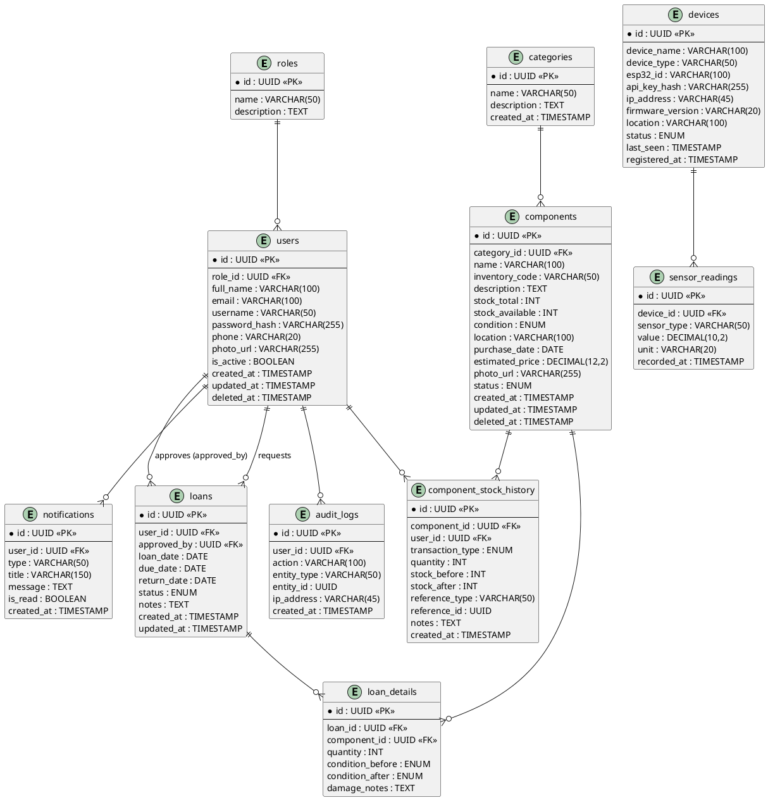

### 12.3 Detail Tabel

#### Tabel: `roles`
| Field | Type | Key | Nullable | Default | Keterangan |
|---|---|---|---|---|---|
| id | UUID | PK | No | gen_random_uuid() | |
| name | VARCHAR(50) | UNIQUE | No | — | 'Admin' / 'User' |
| description | TEXT | | Yes | NULL | |

#### Tabel: `users`
| Field | Type | Key | Nullable | Default | Keterangan |
|---|---|---|---|---|---|
| id | UUID | PK | No | gen_random_uuid() | |
| role_id | UUID | FK → roles.id | No | — | |
| full_name | VARCHAR(100) | | No | — | |
| email | VARCHAR(100) | UNIQUE | No | — | |
| username | VARCHAR(50) | UNIQUE | No | — | |
| password_hash | VARCHAR(255) | | No | — | bcrypt/argon2 |
| phone | VARCHAR(20) | | Yes | NULL | |
| photo_url | VARCHAR(255) | | Yes | NULL | |
| is_active | BOOLEAN | | No | true | |
| created_at | TIMESTAMP | | No | now() | |
| updated_at | TIMESTAMP | | No | now() | |
| deleted_at | TIMESTAMP | | Yes | NULL | soft delete |

*Index:* `idx_users_email`, `idx_users_username`, `idx_users_role_id`

#### Tabel: `categories`
| Field | Type | Key | Nullable | Default |
|---|---|---|---|---|
| id | UUID | PK | No | gen_random_uuid() |
| name | VARCHAR(50) | UNIQUE | No | — |
| description | TEXT | | Yes | NULL |
| created_at | TIMESTAMP | | No | now() |

#### Tabel: `components`
| Field | Type | Key | Nullable | Default | Keterangan |
|---|---|---|---|---|---|
| id | UUID | PK | No | gen_random_uuid() | |
| category_id | UUID | FK → categories.id | No | — | |
| name | VARCHAR(100) | | No | — | |
| inventory_code | VARCHAR(50) | UNIQUE | No | — | mis. `ESP32-001` |
| description | TEXT | | Yes | NULL | |
| stock_total | INT | | No | 0 | CHECK ≥ 0 |
| stock_available | INT | | No | 0 | CHECK ≥ 0 dan ≤ stock_total |
| condition | ENUM('Good','Damaged','Under Repair') | | No | 'Good' | |
| location | VARCHAR(100) | | Yes | NULL | |
| purchase_date | DATE | | Yes | NULL | |
| estimated_price | DECIMAL(12,2) | | Yes | NULL | |
| photo_url | VARCHAR(255) | | Yes | NULL | |
| status | ENUM('Active','Inactive') | | No | 'Active' | |
| created_at | TIMESTAMP | | No | now() | |
| updated_at | TIMESTAMP | | No | now() | |
| deleted_at | TIMESTAMP | | Yes | NULL | soft delete |

*Index:* `idx_components_category_id`, `idx_components_inventory_code`, `idx_components_name`

#### Tabel: `component_stock_history`
| Field | Type | Key | Nullable | Default | Keterangan |
|---|---|---|---|---|---|
| id | UUID | PK | No | gen_random_uuid() | |
| component_id | UUID | FK → components.id | No | — | |
| user_id | UUID | FK → users.id | No | — | pelaku perubahan |
| transaction_type | ENUM('IN','OUT','BORROWED','RETURNED','DAMAGED','REPAIRED','ADJUSTMENT') | | No | — | |
| quantity | INT | | No | — | |
| stock_before | INT | | No | — | |
| stock_after | INT | | No | — | |
| reference_type | VARCHAR(50) | | Yes | NULL | mis. 'loan', 'manual' |
| reference_id | UUID | | Yes | NULL | id transaksi terkait |
| notes | TEXT | | Yes | NULL | |
| created_at | TIMESTAMP | | No | now() | |

*Index:* `idx_stock_history_component_id`, `idx_stock_history_created_at`

#### Tabel: `loans`
| Field | Type | Key | Nullable | Default |
|---|---|---|---|---|
| id | UUID | PK | No | gen_random_uuid() |
| user_id | UUID | FK → users.id | No | — |
| approved_by | UUID | FK → users.id | Yes | NULL |
| loan_date | DATE | | No | — |
| due_date | DATE | | No | — |
| return_date | DATE | | Yes | NULL |
| status | ENUM('Pending','Approved','Borrowed','Returned','Rejected','Overdue','Cancelled') | | No | 'Pending' |
| notes | TEXT | | Yes | NULL |
| created_at | TIMESTAMP | | No | now() |
| updated_at | TIMESTAMP | | No | now() |

*Index:* `idx_loans_user_id`, `idx_loans_status`, `idx_loans_due_date`

#### Tabel: `loan_details`
| Field | Type | Key | Nullable | Default |
|---|---|---|---|---|
| id | UUID | PK | No | gen_random_uuid() |
| loan_id | UUID | FK → loans.id (ON DELETE CASCADE) | No | — |
| component_id | UUID | FK → components.id | No | — |
| quantity | INT | | No | — | CHECK > 0 |
| condition_before | ENUM('Good','Damaged') | | No | 'Good' |
| condition_after | ENUM('Good','Damaged') | | Yes | NULL |
| damage_notes | TEXT | | Yes | NULL |

*Index:* `idx_loan_details_loan_id`, `idx_loan_details_component_id`

#### Tabel: `devices`
| Field | Type | Key | Nullable | Default | Keterangan |
|---|---|---|---|---|---|
| id | UUID | PK | No | gen_random_uuid() | |
| device_name | VARCHAR(100) | | No | — | |
| device_type | VARCHAR(50) | | No | — | mis. 'ESP32-SensorNode' |
| esp32_id | VARCHAR(100) | UNIQUE | No | — | chip ID unik |
| api_key_hash | VARCHAR(255) | | No | — | disimpan hash, bukan plaintext |
| ip_address | VARCHAR(45) | | Yes | NULL | |
| firmware_version | VARCHAR(20) | | Yes | NULL | |
| location | VARCHAR(100) | | Yes | NULL | |
| status | ENUM('Online','Offline','Maintenance') | | No | 'Offline' | |
| last_seen | TIMESTAMP | | Yes | NULL | |
| registered_at | TIMESTAMP | | No | now() | |

*Index:* `idx_devices_esp32_id`, `idx_devices_status`

#### Tabel: `sensor_readings`
| Field | Type | Key | Nullable | Default |
|---|---|---|---|---|
| id | UUID | PK | No | gen_random_uuid() |
| device_id | UUID | FK → devices.id | No | — |
| sensor_type | VARCHAR(50) | | No | — |
| value | DECIMAL(10,2) | | No | — |
| unit | VARCHAR(20) | | Yes | NULL |
| recorded_at | TIMESTAMP | | No | now() |

*Index:* `idx_sensor_readings_device_id`, `idx_sensor_readings_recorded_at` (composite untuk query historical per device)

#### Tabel: `notifications`
| Field | Type | Key | Nullable | Default |
|---|---|---|---|---|
| id | UUID | PK | No | gen_random_uuid() |
| user_id | UUID | FK → users.id | No | — |
| type | VARCHAR(50) | | No | — |
| title | VARCHAR(150) | | No | — |
| message | TEXT | | No | — |
| is_read | BOOLEAN | | No | false |
| created_at | TIMESTAMP | | No | now() |

#### Tabel: `audit_logs`
| Field | Type | Key | Nullable | Default |
|---|---|---|---|---|
| id | UUID | PK | No | gen_random_uuid() |
| user_id | UUID | FK → users.id | Yes | NULL |
| action | VARCHAR(100) | | No | — |
| entity_type | VARCHAR(50) | | No | — |
| entity_id | UUID | | Yes | NULL |
| ip_address | VARCHAR(45) | | Yes | NULL |
| created_at | TIMESTAMP | | No | now() |

### 12.4 SQL DDL (PostgreSQL)

```sql
CREATE EXTENSION IF NOT EXISTS "pgcrypto";

CREATE TABLE roles (
  id UUID PRIMARY KEY DEFAULT gen_random_uuid(),
  name VARCHAR(50) UNIQUE NOT NULL,
  description TEXT
);

CREATE TABLE users (
  id UUID PRIMARY KEY DEFAULT gen_random_uuid(),
  role_id UUID NOT NULL REFERENCES roles(id) ON DELETE RESTRICT,
  full_name VARCHAR(100) NOT NULL,
  email VARCHAR(100) UNIQUE NOT NULL,
  username VARCHAR(50) UNIQUE NOT NULL,
  password_hash VARCHAR(255) NOT NULL,
  phone VARCHAR(20),
  photo_url VARCHAR(255),
  is_active BOOLEAN NOT NULL DEFAULT true,
  created_at TIMESTAMP NOT NULL DEFAULT now(),
  updated_at TIMESTAMP NOT NULL DEFAULT now(),
  deleted_at TIMESTAMP
);
CREATE INDEX idx_users_role_id ON users(role_id);

CREATE TABLE categories (
  id UUID PRIMARY KEY DEFAULT gen_random_uuid(),
  name VARCHAR(50) UNIQUE NOT NULL,
  description TEXT,
  created_at TIMESTAMP NOT NULL DEFAULT now()
);

CREATE TABLE components (
  id UUID PRIMARY KEY DEFAULT gen_random_uuid(),
  category_id UUID NOT NULL REFERENCES categories(id) ON DELETE RESTRICT,
  name VARCHAR(100) NOT NULL,
  inventory_code VARCHAR(50) UNIQUE NOT NULL,
  description TEXT,
  stock_total INT NOT NULL DEFAULT 0 CHECK (stock_total >= 0),
  stock_available INT NOT NULL DEFAULT 0 CHECK (stock_available >= 0),
  condition VARCHAR(20) NOT NULL DEFAULT 'Good'
    CHECK (condition IN ('Good','Damaged','Under Repair')),
  location VARCHAR(100),
  purchase_date DATE,
  estimated_price DECIMAL(12,2),
  photo_url VARCHAR(255),
  status VARCHAR(20) NOT NULL DEFAULT 'Active'
    CHECK (status IN ('Active','Inactive')),
  created_at TIMESTAMP NOT NULL DEFAULT now(),
  updated_at TIMESTAMP NOT NULL DEFAULT now(),
  deleted_at TIMESTAMP,
  CHECK (stock_available <= stock_total)
);
CREATE INDEX idx_components_category_id ON components(category_id);
CREATE INDEX idx_components_name ON components(name);

CREATE TABLE component_stock_history (
  id UUID PRIMARY KEY DEFAULT gen_random_uuid(),
  component_id UUID NOT NULL REFERENCES components(id) ON DELETE RESTRICT,
  user_id UUID NOT NULL REFERENCES users(id) ON DELETE RESTRICT,
  transaction_type VARCHAR(20) NOT NULL
    CHECK (transaction_type IN ('IN','OUT','BORROWED','RETURNED','DAMAGED','REPAIRED','ADJUSTMENT')),
  quantity INT NOT NULL,
  stock_before INT NOT NULL,
  stock_after INT NOT NULL,
  reference_type VARCHAR(50),
  reference_id UUID,
  notes TEXT,
  created_at TIMESTAMP NOT NULL DEFAULT now()
);
CREATE INDEX idx_stock_history_component_id ON component_stock_history(component_id);
CREATE INDEX idx_stock_history_created_at ON component_stock_history(created_at);

CREATE TABLE loans (
  id UUID PRIMARY KEY DEFAULT gen_random_uuid(),
  user_id UUID NOT NULL REFERENCES users(id) ON DELETE RESTRICT,
  approved_by UUID REFERENCES users(id) ON DELETE SET NULL,
  loan_date DATE NOT NULL,
  due_date DATE NOT NULL,
  return_date DATE,
  status VARCHAR(20) NOT NULL DEFAULT 'Pending'
    CHECK (status IN ('Pending','Approved','Borrowed','Returned','Rejected','Overdue','Cancelled')),
  notes TEXT,
  created_at TIMESTAMP NOT NULL DEFAULT now(),
  updated_at TIMESTAMP NOT NULL DEFAULT now()
);
CREATE INDEX idx_loans_user_id ON loans(user_id);
CREATE INDEX idx_loans_status ON loans(status);

CREATE TABLE loan_details (
  id UUID PRIMARY KEY DEFAULT gen_random_uuid(),
  loan_id UUID NOT NULL REFERENCES loans(id) ON DELETE CASCADE,
  component_id UUID NOT NULL REFERENCES components(id) ON DELETE RESTRICT,
  quantity INT NOT NULL CHECK (quantity > 0),
  condition_before VARCHAR(20) NOT NULL DEFAULT 'Good',
  condition_after VARCHAR(20),
  damage_notes TEXT
);
CREATE INDEX idx_loan_details_loan_id ON loan_details(loan_id);

CREATE TABLE devices (
  id UUID PRIMARY KEY DEFAULT gen_random_uuid(),
  device_name VARCHAR(100) NOT NULL,
  device_type VARCHAR(50) NOT NULL,
  esp32_id VARCHAR(100) UNIQUE NOT NULL,
  api_key_hash VARCHAR(255) NOT NULL,
  ip_address VARCHAR(45),
  firmware_version VARCHAR(20),
  location VARCHAR(100),
  status VARCHAR(20) NOT NULL DEFAULT 'Offline'
    CHECK (status IN ('Online','Offline','Maintenance')),
  last_seen TIMESTAMP,
  registered_at TIMESTAMP NOT NULL DEFAULT now()
);
CREATE INDEX idx_devices_status ON devices(status);

CREATE TABLE sensor_readings (
  id UUID PRIMARY KEY DEFAULT gen_random_uuid(),
  device_id UUID NOT NULL REFERENCES devices(id) ON DELETE CASCADE,
  sensor_type VARCHAR(50) NOT NULL,
  value DECIMAL(10,2) NOT NULL,
  unit VARCHAR(20),
  recorded_at TIMESTAMP NOT NULL DEFAULT now()
);
CREATE INDEX idx_sensor_readings_device_time ON sensor_readings(device_id, recorded_at);

CREATE TABLE notifications (
  id UUID PRIMARY KEY DEFAULT gen_random_uuid(),
  user_id UUID NOT NULL REFERENCES users(id) ON DELETE CASCADE,
  type VARCHAR(50) NOT NULL,
  title VARCHAR(150) NOT NULL,
  message TEXT NOT NULL,
  is_read BOOLEAN NOT NULL DEFAULT false,
  created_at TIMESTAMP NOT NULL DEFAULT now()
);

CREATE TABLE audit_logs (
  id UUID PRIMARY KEY DEFAULT gen_random_uuid(),
  user_id UUID REFERENCES users(id) ON DELETE SET NULL,
  action VARCHAR(100) NOT NULL,
  entity_type VARCHAR(50) NOT NULL,
  entity_id UUID,
  ip_address VARCHAR(45),
  created_at TIMESTAMP NOT NULL DEFAULT now()
);
```

### 12.5 Contoh Data (Seeding)

```sql
INSERT INTO roles (name, description) VALUES
('Admin', 'Pengelola laboratorium'),
('User', 'Mahasiswa peminjam komponen');

INSERT INTO categories (name) VALUES
('Microcontroller'), ('Sensor'), ('Actuator'), ('Motor'),
('Display'), ('Communication Module'), ('Power'), ('Passive Component'), ('Other');

-- contoh komponen awal (category_id disesuaikan hasil insert di atas)
INSERT INTO components (category_id, name, inventory_code, stock_total, stock_available, location)
VALUES
((SELECT id FROM categories WHERE name='Microcontroller'), 'ESP32 DevKit V1', 'MCU-ESP32-001', 10, 10, 'Rak A1'),
((SELECT id FROM categories WHERE name='Sensor'), 'HC-SR04 Ultrasonic', 'SNS-HCSR04-001', 15, 15, 'Rak B2'),
((SELECT id FROM categories WHERE name='Sensor'), 'DHT22', 'SNS-DHT22-001', 12, 12, 'Rak B2'),
((SELECT id FROM categories WHERE name='Actuator'), 'Servo SG90', 'ACT-SG90-001', 8, 8, 'Rak C1');
```

---

## 13. UML

### 13.1 Use Case Diagram

**Aktor:** Admin, User/Mahasiswa, IoT Device (ESP32)

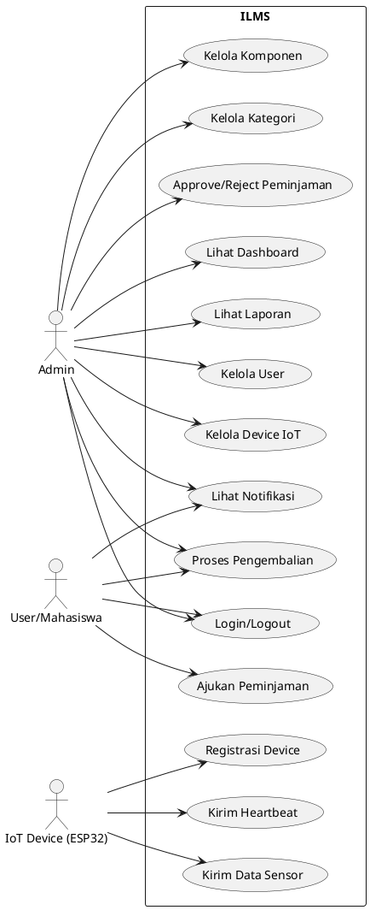

### 13.2 Activity Diagram

**a) Login**
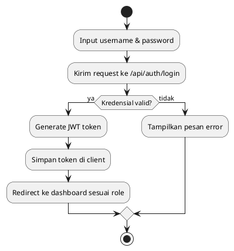

**b) Meminjam Komponen**
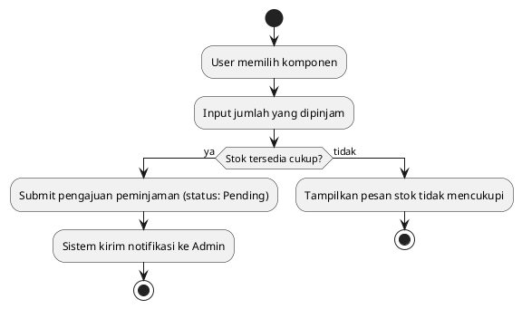

**c) Persetujuan Peminjaman**
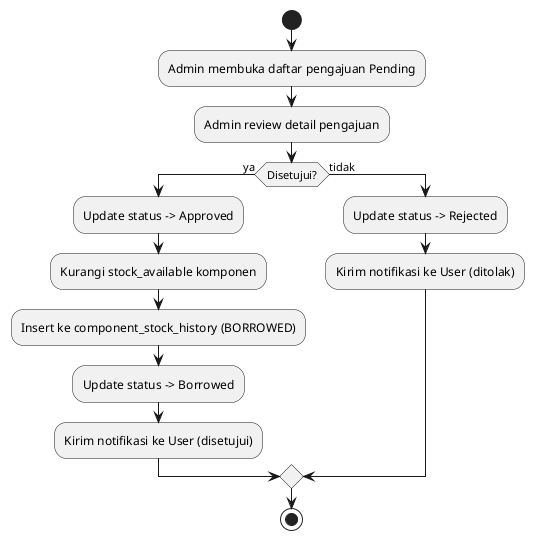

**d) Pengembalian Komponen**
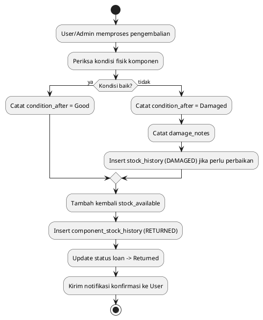

**e) Registrasi IoT Device**
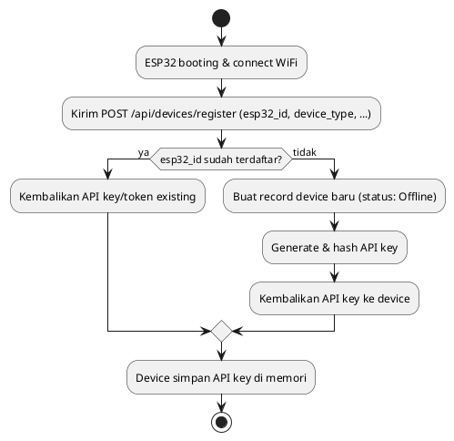

**f) Pengiriman Data Sensor**
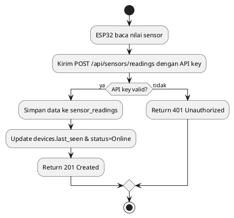

### 13.3 Sequence Diagram

**a) Login**
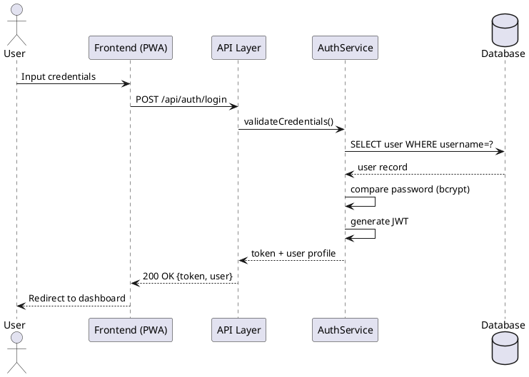

**b) CRUD Component (contoh: Create)**
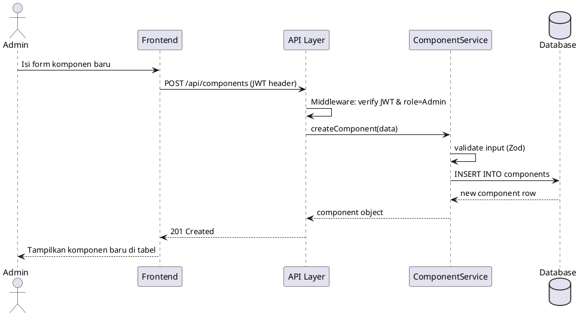

**c) Borrowing**
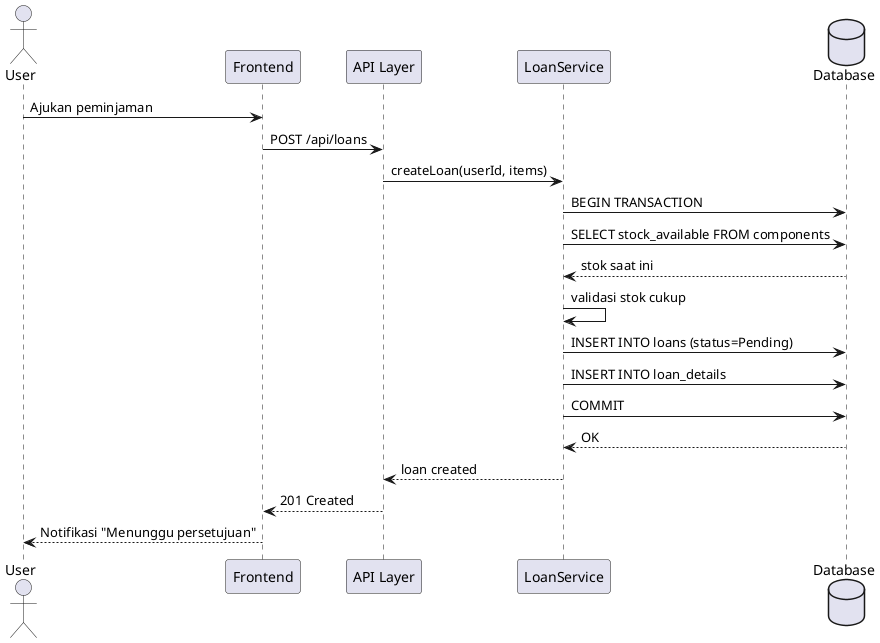

**d) Return**
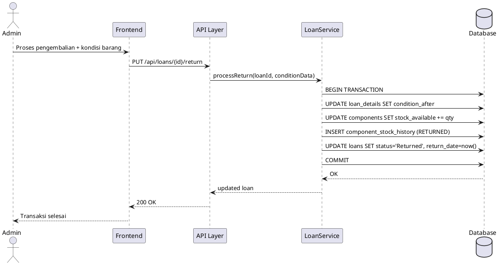

**e) ESP32 Mengirim Sensor Data**
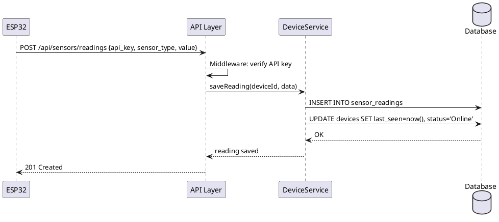

**f) Device Heartbeat**
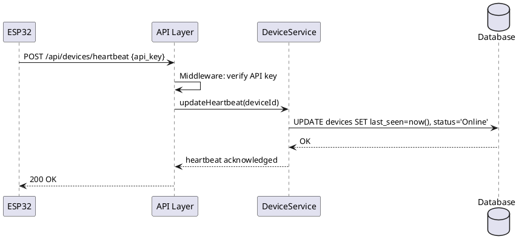

### 13.4 Class Diagram

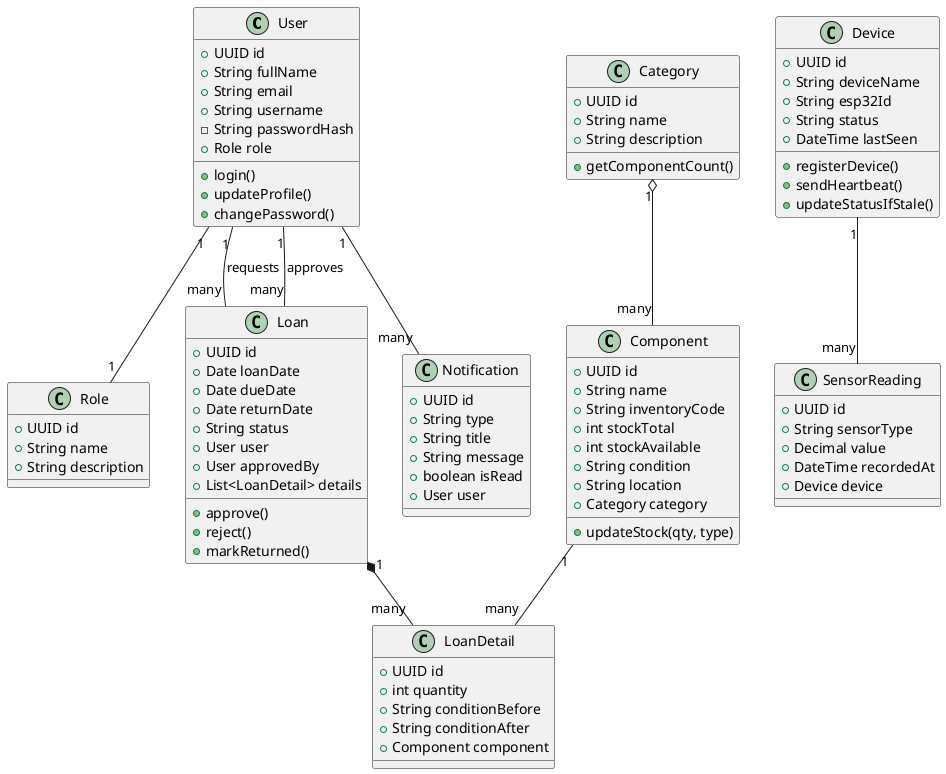

### 13.5 State Diagram

**a) Status Peminjaman (Loan)**
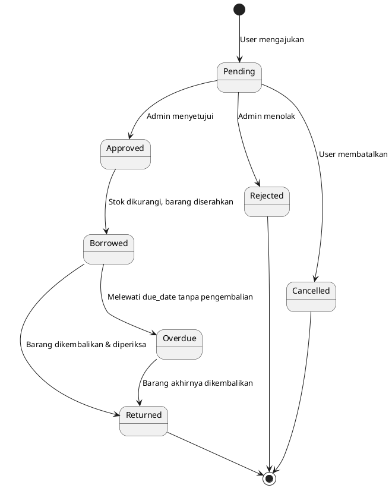

**b) Status Device**
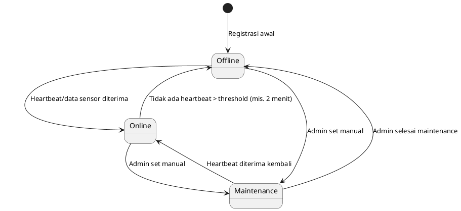

*Catatan implementasi:* transisi `Online → Offline` tidak dipicu oleh event langsung, melainkan oleh **scheduled job** (cron) yang memeriksa `last_seen` setiap device secara berkala.

---

## 14. REST API DESIGN

**Base URL:** `/api`
**Format:** JSON
**Autentikasi Web:** `Authorization: Bearer <JWT>`
**Autentikasi Device:** `X-API-Key: <device_api_key>`

### 14.1 Authentication

| Method | Endpoint | Auth | Deskripsi |
|---|---|---|---|
| POST | `/api/auth/login` | Public | Login, return JWT |
| POST | `/api/auth/logout` | JWT | Invalidasi sesi (blacklist token/opsional) |
| POST | `/api/auth/register` | Public/Admin only | Registrasi user baru (jika diaktifkan) |
| GET | `/api/auth/me` | JWT | Ambil profil user login |
| PUT | `/api/auth/change-password` | JWT | Ganti password |

**Contoh — POST /api/auth/login**
- Request body: `{ "username": "string", "password": "string" }`
- Response 200: `{ "token": "jwt...", "user": { "id", "fullName", "role" } }`
- Response 401: `{ "error": "Invalid credentials" }`

### 14.2 Components

| Method | Endpoint | Auth | Deskripsi |
|---|---|---|---|
| GET | `/api/components` | JWT | List + filter/search/pagination (`?search=&category=&page=&limit=`) |
| GET | `/api/components/{id}` | JWT | Detail komponen |
| POST | `/api/components` | JWT (Admin) | Tambah komponen |
| PUT | `/api/components/{id}` | JWT (Admin) | Update komponen |
| DELETE | `/api/components/{id}` | JWT (Admin) | Soft delete komponen |

**Contoh — POST /api/components**
- Request: `{ "categoryId", "name", "inventoryCode", "stockTotal", "location", ... }`
- Response 201: object komponen baru
- Response 400: `{ "error": "Validation failed", "details": [...] }`
- Response 409: `{ "error": "Inventory code already exists" }`

### 14.3 Categories

| Method | Endpoint | Auth | Deskripsi |
|---|---|---|---|
| GET | `/api/categories` | JWT | List kategori + jumlah komponen |
| POST | `/api/categories` | JWT (Admin) | Tambah kategori |
| PUT | `/api/categories/{id}` | JWT (Admin) | Update kategori |
| DELETE | `/api/categories/{id}` | JWT (Admin) | Hapus kategori (ditolak jika masih dipakai komponen) |

### 14.4 Loans (Borrowing)

| Method | Endpoint | Auth | Deskripsi |
|---|---|---|---|
| GET | `/api/loans` | JWT | List transaksi (Admin: semua; User: milik sendiri) |
| GET | `/api/loans/{id}` | JWT | Detail transaksi |
| POST | `/api/loans` | JWT (User) | Ajukan peminjaman |
| PUT | `/api/loans/{id}/approve` | JWT (Admin) | Setujui peminjaman |
| PUT | `/api/loans/{id}/reject` | JWT (Admin) | Tolak peminjaman |
| PUT | `/api/loans/{id}/return` | JWT (Admin) | Proses pengembalian |
| PUT | `/api/loans/{id}/cancel` | JWT (User) | Batalkan pengajuan (hanya saat Pending) |

**Contoh — POST /api/loans**
- Request: `{ "items": [{ "componentId", "quantity" }], "dueDate": "2026-10-01" }`
- Response 201: object loan (status: Pending)
- Response 400: `{ "error": "Insufficient stock", "componentId": "..." }`

**Contoh — PUT /api/loans/{id}/return**
- Request: `{ "items": [{ "loanDetailId", "conditionAfter", "damageNotes?" }] }`
- Response 200: object loan (status: Returned)

### 14.5 Stock History

| Method | Endpoint | Auth | Deskripsi |
|---|---|---|---|
| GET | `/api/components/{id}/history` | JWT (Admin) | Riwayat perubahan stok komponen tertentu |
| POST | `/api/components/{id}/adjust-stock` | JWT (Admin) | Penyesuaian stok manual (barang masuk/rusak dsb.) |

### 14.6 Devices (IoT)

| Method | Endpoint | Auth | Deskripsi |
|---|---|---|---|
| GET | `/api/devices` | JWT (Admin) | List device + status |
| GET | `/api/devices/{id}` | JWT (Admin) | Detail device |
| PUT | `/api/devices/{id}` | JWT (Admin) | Update data device |
| DELETE | `/api/devices/{id}` | JWT (Admin) | Hapus device |
| **POST** | **`/api/devices/register`** | **API Key/Public+Secret** | ESP32 registrasi diri |
| **POST** | **`/api/devices/heartbeat`** | **API Key** | ESP32 kirim heartbeat |
| GET | `/api/devices/{id}/config` | API Key | Ambil konfigurasi device (interval kirim data, dsb.) |

**Contoh — POST /api/devices/register**
- Request: `{ "esp32Id", "deviceName", "deviceType", "firmwareVersion" }`
- Response 201: `{ "deviceId", "apiKey" }` (apiKey hanya ditampilkan sekali)
- Response 200 (jika sudah terdaftar): `{ "deviceId", "message": "Already registered" }`

**Contoh — POST /api/devices/heartbeat**
- Header: `X-API-Key: <key>`
- Response 200: `{ "status": "acknowledged", "serverTime": "..." }`
- Response 401: `{ "error": "Invalid API key" }`

### 14.7 Sensors (IoT Monitoring)

| Method | Endpoint | Auth | Deskripsi |
|---|---|---|---|
| POST | `/api/sensors/readings` | API Key | ESP32 kirim data sensor |
| GET | `/api/sensors/readings` | JWT (Admin) | List data sensor (filter device/type/tanggal) |
| GET | `/api/devices/{id}/readings/latest` | JWT | Nilai sensor terkini per device |
| GET | `/api/devices/{id}/readings/history` | JWT | Data historis untuk chart |

**Contoh — POST /api/sensors/readings**
- Request: `{ "sensorType": "temperature", "value": 28.5, "unit": "C" }`
- Response 201: object reading tersimpan

### 14.8 Reports & Dashboard

| Method | Endpoint | Auth | Deskripsi |
|---|---|---|---|
| GET | `/api/dashboard/summary` | JWT (Admin) | Statistik ringkas dashboard |
| GET | `/api/reports/inventory` | JWT (Admin) | Laporan inventaris (+`?format=csv/pdf`) |
| GET | `/api/reports/borrowing` | JWT (Admin) | Laporan peminjaman |
| GET | `/api/reports/damage` | JWT (Admin) | Laporan kerusakan |
| GET | `/api/reports/iot` | JWT (Admin) | Laporan status & histori device |

### 14.9 Notifications

| Method | Endpoint | Auth | Deskripsi |
|---|---|---|---|
| GET | `/api/notifications` | JWT | List notifikasi user login |
| PUT | `/api/notifications/{id}/read` | JWT | Tandai sudah dibaca |
| PUT | `/api/notifications/read-all` | JWT | Tandai semua sudah dibaca |

### 14.10 Konvensi HTTP Status

| Kode | Arti |
|---|---|
| 200 | OK (GET/PUT berhasil) |
| 201 | Created (POST berhasil membuat resource) |
| 400 | Bad Request (validasi gagal) |
| 401 | Unauthorized (token/API key tidak valid) |
| 403 | Forbidden (role tidak memiliki akses) |
| 404 | Not Found |
| 409 | Conflict (duplikasi data, mis. inventory_code) |
| 422 | Unprocessable Entity (stok tidak cukup, dsb.) |
| 500 | Internal Server Error |

**Format error standar:**
```json
{
  "error": "Insufficient stock",
  "code": "STOCK_INSUFFICIENT",
  "details": { "componentId": "...", "available": 2, "requested": 5 }
}
```

---

## 15. PWA ARCHITECTURE

| Komponen | Implementasi |
|---|---|
| **Web App Manifest** | `manifest.json` berisi nama app, icon (192/512px), theme_color, display: `standalone`, start_url |
| **Service Worker** | Digenerate via `vite-plugin-pwa` (Workbox) — meng-cache asset statis (JS/CSS/icon) dan halaman shell |
| **Cache Strategy** | `CacheFirst` untuk asset statis (JS/CSS/gambar); `NetworkFirst` untuk data API (fallback ke cache saat offline); `StaleWhileRevalidate` untuk data referensi (kategori) |
| **Installable** | Browser menampilkan prompt "Add to Home Screen" otomatis setelah kriteria PWA terpenuhi (manifest valid + HTTPS + service worker) |
| **Responsive/Mobile-first** | Tailwind breakpoints, layout diuji dari 360px ke atas |
| **Push Notification** | Web Push API (opsional, fase lanjut) — gratis, tidak butuh layanan pihak ketiga berbayar |

### 15.1 Yang Bisa Bekerja Offline
- Melihat **cache terakhir** dari: daftar komponen, kategori, profil user.
- Navigasi antar halaman (app shell sudah ter-cache).
- Draft form (disimpan sementara di IndexedDB, dikirim saat online kembali — opsional/fase lanjut).

### 15.2 Yang Wajib Online
- Login/logout (butuh verifikasi server).
- Semua operasi tulis: pengajuan peminjaman, approve/reject, update stok.
- Data real-time (status device, dashboard, notifikasi baru).
- Komunikasi ESP32 (device sama sekali tidak memakai PWA/offline logic — selalu online saat kirim data).

---

## 16. IoT ARCHITECTURE

### 16.1 Alur Komunikasi
```
[Sensor Fisik] → [ESP32: baca nilai] → [WiFi] → [HTTP POST + API Key]
     → [REST API: validasi & simpan] → [Database]
                                      → [Update devices.last_seen/status]
                                      → [Trigger notifikasi jika perlu (mis. offline→online)]
```

### 16.2 Keamanan Komunikasi Device
- Setiap device memiliki **API key unik** (bukan share password admin).
- API key disimpan di server dalam bentuk **hash**, bukan plaintext.
- Endpoint device (`/register`, `/heartbeat`, `/sensors/readings`) **terpisah** dari endpoint web (JWT), sehingga kompromi satu device tidak membuka akses ke seluruh sistem.
- Rate limiting diterapkan khusus endpoint device untuk mencegah flooding data.

### 16.3 Deteksi Online/Offline
Job terjadwal (cron, mis. tiap 1 menit) memeriksa: jika `now() - last_seen > THRESHOLD (mis. 2× interval heartbeat normal)`, maka `status` diubah menjadi `Offline` dan notifikasi "Device offline" dikirim ke Admin. Saat heartbeat/data sensor berikutnya diterima, status otomatis kembali `Online` dan notifikasi "Device kembali online" dikirim.

### 16.4 Modularitas Monitoring
Tabel `sensor_readings` dan endpoint `/api/sensors/*` berdiri independen dari modul inventory. Menambah jenis sensor baru cukup menambah nilai `sensor_type` baru — **tidak perlu migrasi skema**. Ini memenuhi syarat "modul 8 dapat dikembangkan tanpa mengubah modul inventory utama".

---

## 17. SECURITY ARCHITECTURE

| Ancaman | Mitigasi |
|---|---|
| **Password lemah/bocor** | Hashing dengan bcrypt/argon2 (salt otomatis), kebijakan panjang minimum password |
| **Brute-force login** | Rate limiting per IP/username pada `/api/auth/login`, lockout sementara setelah N percobaan gagal |
| **SQL Injection** | Parameterized query via ORM (Prisma) — tidak ada raw string concatenation SQL |
| **XSS** | Sanitasi input, escape output di frontend (React secara default meng-escape), Content-Security-Policy header |
| **CSRF** | Karena API berbasis JWT di header (bukan cookie), risiko CSRF klasik berkurang; jika pakai cookie, tambahkan CSRF token |
| **Akses tidak sah antar role** | Middleware RBAC di setiap endpoint sensitif (cek role dari JWT payload) |
| **Device credential dicuri** | API key per device (bukan shared), dapat di-revoke individual dari panel admin |
| **Data sensitif di kode** | Semua secret (DB credential, JWT secret) disimpan di `.env`, tidak pernah di-commit ke Git (`.gitignore`) |
| **Request API device palsu (flooding)** | Rate limiting endpoint device, validasi `esp32_id` terdaftar |
| **Tidak ada jejak audit** | Tabel `audit_logs` mencatat aksi sensitif (login, delete, approve, dsb.) |
| **Man-in-the-middle** | Wajib HTTPS di production (termasuk komunikasi ESP32 jika deployment production) |

### 17.1 Prinsip Tambahan
- **Least privilege:** endpoint Admin-only ditolak tegas (403) untuk role User, bukan disembunyikan di UI saja.
- **Input validation** di layer API (Zod schema) sebelum masuk business logic — mencegah data cacat masuk database.
- **Environment separation:** `.env.development`, `.env.production` terpisah dengan secret berbeda.

---

## 18. PROJECT STRUCTURE

```
ilms/
├── frontend/
│   ├── public/
│   │   ├── manifest.json
│   │   └── icons/
│   ├── src/
│   │   ├── components/       # UI reusable (Button, Table, Card, dsb.)
│   │   ├── pages/             # Halaman: Dashboard, Components, Loans, Devices, dsb.
│   │   ├── layouts/           # AdminLayout, UserLayout
│   │   ├── services/          # axios/fetch wrapper ke REST API
│   │   ├── hooks/              # custom hooks (useAuth, useComponents, dsb.)
│   │   ├── context/            # AuthContext
│   │   ├── routes/             # React Router config + ProtectedRoute
│   │   └── main.tsx
│   ├── vite.config.ts          # termasuk konfigurasi vite-plugin-pwa
│   └── package.json
│
├── backend/
│   ├── src/
│   │   ├── controllers/        # Handler request per modul
│   │   ├── services/           # Business logic (LoanService, DeviceService, dsb.)
│   │   ├── repositories/       # Akses data (jika tidak langsung pakai Prisma di service)
│   │   ├── middlewares/        # auth.middleware.ts, role.middleware.ts, apiKey.middleware.ts
│   │   ├── routes/             # Definisi endpoint per modul
│   │   ├── validators/         # Zod schema per request
│   │   ├── jobs/                # cron job: cek device offline, cek loan overdue
│   │   ├── utils/                # helper (hashing, jwt, response formatter)
│   │   └── app.ts
│   ├── prisma/
│   │   ├── schema.prisma
│   │   ├── migrations/
│   │   └── seed.ts
│   └── package.json
│
├── database/
│   └── ddl.sql                 # backup DDL manual (di luar Prisma) untuk dokumentasi
│
├── iot/
│   └── esp32/
│       ├── sensor_node.ino     # firmware contoh (baca sensor + kirim data)
│       └── config.h            # WiFi SSID/Password, API endpoint (jangan commit versi asli)
│
├── docs/
│   ├── ERD.png / ERD.puml
│   ├── UML/                    # semua diagram .puml & hasil render
│   ├── API.md                  # dokumentasi endpoint (atau Postman collection)
│   └── screenshots/
│
├── tests/
│   ├── unit/
│   ├── integration/
│   └── api/
│
├── .env.example
├── docker-compose.yml          # (opsional) service Postgres lokal
└── README.md
```

**Fungsi folder penting:**
- `frontend/src/services` — satu-satunya tempat pemanggilan `fetch/axios`, memudahkan ganti base URL API.
- `backend/src/jobs` — menjalankan pengecekan berkala (device offline, loan overdue) tanpa campur dengan logic request-response biasa.
- `iot/esp32` — firmware terpisah dari kode web agar mahasiswa dapat membuka project ini langsung di Arduino IDE/PlatformIO.
- `docs/` — pusat semua diagram PlantUML dan dokumentasi API untuk keperluan portofolio & laporan tugas akhir.

---

## 19. DEVELOPMENT ROADMAP

| Fase | Tujuan | Task Utama | Output | Dependency | Acceptance Criteria |
|---|---|---|---|---|---|
| **1. Requirement & Analysis** | Menentukan kebutuhan final | Wawancara kebutuhan lab, finalisasi scope MVP | Dokumen requirement (bagian 1–7 blueprint ini) | — | Semua requirement disepakati & terdokumentasi |
| **2. Database & ERD** | Desain data | Rancang ERD, buat schema Prisma, migration awal | ERD + migration berjalan | Fase 1 | Semua tabel MVP (users–loan_details) berhasil dibuat & di-seed |
| **3. Backend & REST API** | Bangun fondasi API | Setup Express/NestJS, struktur folder, endpoint auth & components | API auth + CRUD components berjalan (tes via Postman) | Fase 2 | Semua endpoint MVP mengembalikan response sesuai spec |
| **4. Frontend** | Bangun UI dasar | Setup React+Vite+Tailwind, layout, routing | Skeleton UI dengan navigasi | Fase 3 (kontrak API) | UI dapat memanggil API dan menampilkan data dummy/nyata |
| **5. Authentication** | Login & RBAC | Implement JWT, middleware role, halaman login | Login berfungsi untuk Admin & User | Fase 3, 4 | User tidak bisa akses halaman/endpoint di luar rolenya |
| **6. Inventory** | Modul komponen & kategori | CRUD component/category (FE+BE), search/filter/pagination | Modul inventory lengkap | Fase 5 | Admin dapat CRUD komponen; stok tampil real-time |
| **7. Borrowing System** | Modul peminjaman | Alur ajukan-approve-return, stock_history otomatis | Modul peminjaman lengkap end-to-end | Fase 6 | State transition loan sesuai diagram state; stok konsisten |
| **8. Dashboard & Reports** | Insight data | Endpoint summary, chart FE, export CSV/PDF | Dashboard & laporan berfungsi | Fase 7 | Statistik dashboard sesuai data aktual di DB |
| **9. PWA** | Installable & offline-ready | Konfigurasi manifest + service worker, uji offline | App dapat di-install & menampilkan cache saat offline | Fase 8 | Lighthouse PWA audit skor baik (installable, offline shell) |
| **10. ESP32 Integration** | Koneksi perangkat nyata | Endpoint register/heartbeat, firmware ESP32 dasar | Device dapat registrasi & terdeteksi online/offline | Fase 3 (API layer siap) | Device muncul di panel admin dengan status akurat |
| **11. IoT Monitoring** | Data sensor | Endpoint sensor readings, chart historis di FE | Data sensor tersimpan & tervisualisasi | Fase 10 | Grafik menampilkan data sensor real dari ESP32 |
| **12. Testing & Deployment** | Kualitas & rilis | Unit/integration/API test, deploy ke hosting gratis | Aplikasi live + test coverage memadai | Semua fase | Aplikasi dapat diakses publik, checklist test lulus |

---

## 20. TESTING STRATEGY

| Jenis Test | Tools | Cakupan |
|---|---|---|
| Unit Testing | Jest/Vitest | Fungsi business logic (mis. perhitungan stok, validasi status transition) |
| Integration Testing | Jest + Supertest | Interaksi service ↔ database (mis. LoanService dengan Prisma test DB) |
| API Testing | Postman/Thunder Client + Newman (CI) | Setiap endpoint sesuai kontrak (status code, body) |
| Database Testing | SQL script/Prisma test | Constraint (CHECK stock_available ≤ stock_total), cascade behavior |
| UI Testing | React Testing Library | Render komponen, interaksi form |
| Authentication Testing | Supertest | Login sukses/gagal, token expired, akses tanpa token |
| Authorization Testing | Supertest | User mencoba akses endpoint Admin → harus 403 |
| PWA Testing | Lighthouse | Installability, offline shell, manifest valid |
| IoT Communication Testing | Postman/simulasi HTTP dari script | Register device, heartbeat, kirim data sensor dengan/tanpa API key valid |
| Error Handling | Manual + automated | Response error konsisten format & status code |

### 20.1 Contoh Test Case

| ID | Fitur | Skenario | Expected Result |
|---|---|---|---|
| TC-01 | Login | Username/password benar | 200, token dikembalikan |
| TC-02 | Login | Password salah | 401, pesan error generik (tidak bocorkan detail) |
| TC-03 | Borrowing | Ajukan pinjam melebihi stok tersedia | 422, `STOCK_INSUFFICIENT` |
| TC-04 | Borrowing | Approve loan Pending | Status → Approved → Borrowed, stok berkurang sesuai qty |
| TC-05 | Return | Kembalikan barang kondisi rusak | `condition_after=Damaged`, history `DAMAGED` tercatat |
| TC-06 | RBAC | User akses `DELETE /api/components/{id}` | 403 Forbidden |
| TC-07 | Device Register | esp32_id baru | 201, apiKey dikembalikan sekali |
| TC-08 | Device Heartbeat | API key salah | 401 Unauthorized |
| TC-09 | Sensor Reading | Kirim data valid | 201, `devices.last_seen` terupdate |
| TC-10 | Device Offline Detection | last_seen > threshold | Job cron mengubah status → Offline + notifikasi terkirim |

---

## 21. DEPLOYMENT ARCHITECTURE

### 21.1 Development (Local)
- Backend & frontend dijalankan lokal (`npm run dev`), database PostgreSQL lokal atau via Docker Compose.
- ESP32 terhubung ke WiFi yang sama dengan mesin dev, mengarah ke IP lokal backend (mis. `http://192.168.x.x:3000`) — cukup untuk demo/testing.

### 21.2 Production (Opsi Gratis/Low-Cost)

| Komponen | Rekomendasi Gratis | Catatan |
|---|---|---|
| Frontend (static build) | **Vercel** / **Netlify** | Auto-deploy dari GitHub, HTTPS gratis |
| Backend (Node.js API) | **Render** (free tier) / **Railway** | Perhatikan cold-start pada tier gratis |
| Database | **Supabase** (Postgres) / **Neon** | Tier gratis cukup untuk skala lab |
| Domain | Subdomain gratis dari platform (mis. `*.vercel.app`) atau domain `.my.id` murah | HTTPS otomatis disediakan platform |
| IoT API Endpoint | URL backend production (HTTPS) | ESP32 dikonfigurasi dengan endpoint ini, bukan IP lokal |

### 21.3 Checklist Deployment
- Environment variable (`DATABASE_URL`, `JWT_SECRET`, dsb.) diatur di dashboard hosting, **tidak** hardcode.
- HTTPS wajib aktif sebelum ESP32 production dikonfigurasi (agar `HTTPClient` ESP32 memakai endpoint aman).
- Jalankan `prisma migrate deploy` (bukan `migrate dev`) di production.
- Set CORS backend hanya mengizinkan origin frontend production.

---

## 22. GITHUB DOCUMENTATION

Struktur `README.md` yang direkomendasikan:

```
README.md
├── Project Overview          (ringkasan 3-4 kalimat + badge status)
├── Features                  (list fitur per modul, dengan screenshot)
├── Architecture               (diagram layer dari bagian 8)
├── Tech Stack                 (tabel dari bagian 10)
├── Database                   (ringkasan ERD + link ke docs/ERD.puml)
├── API Documentation           (link ke docs/API.md atau Postman collection)
├── UML                          (thumbnail diagram + link folder docs/UML)
├── Installation                 (langkah setup lokal: clone, .env, migrate, run)
├── Configuration                 (daftar environment variable)
├── ESP32 Setup                    (cara flash firmware, isi config.h)
├── Screenshots                     (dashboard, halaman utama tiap modul)
├── Testing                          (cara menjalankan test suite)
└── Future Development                (roadmap lanjutan, bagian 24)
```

Tambahan yang disarankan untuk kredibilitas portfolio:
- Badge GitHub Actions (CI status) jika ada pipeline testing otomatis.
- Link demo live (Vercel/Render).
- GIF singkat alur "ajukan pinjam → approve → kembalikan" di bagian Features.

---

## 23. PORTFOLIO DEVELOPMENT STRATEGY

1. **Presentasikan sebagai studi kasus nyata**, bukan hanya "tugas kuliah" — jelaskan masalah lab yang diselesaikan, bukan cuma fitur teknis.
2. **Sertakan diagram arsitektur & ERD di README** — reviewer/recruiter sering menilai kemampuan desain sistem, bukan hanya kemampuan coding.
3. **Deploy live demo** dengan akun demo (Admin & User) agar dapat dicoba langsung tanpa setup.
4. **Tulis studi kasus terpisah** (mis. di blog pribadi/LinkedIn) yang menjelaskan keputusan arsitektur: kenapa REST bukan MQTT, kenapa PostgreSQL, dsb. — ini menunjukkan *reasoning*, bukan hanya eksekusi.
5. **Video demo 2-3 menit** menunjukkan alur utama + integrasi ESP32 fisik (sangat menonjol karena melibatkan hardware asli).
6. **Highlight bagian IoT** secara khusus di CV/portfolio karena kombinasi Web+DB+IoT jarang ditemukan di proyek mahasiswa kebanyakan yang hanya CRUD biasa.

---

## 24. FUTURE DEVELOPMENT

Pengembangan lanjutan yang **tidak masuk MVP** namun konsisten dengan arsitektur yang sudah dirancang (tidak butuh perombakan):

| Ide Pengembangan | Kesiapan Arsitektur Saat Ini |
|---|---|
| Protokol **MQTT** untuk komunikasi device real-time | Bisa ditambahkan sebagai jalur alternatif ke `DeviceService`/`SensorService` tanpa mengubah skema DB |
| **Push notification** browser penuh (Web Push) | Tabel `notifications` sudah siap; tinggal tambah subscription endpoint |
| **Predictive maintenance** (ML sederhana dari histori sensor) | `sensor_readings` sudah ternormalisasi & timestamped, siap jadi dataset |
| **QR Code** pada tiap komponen untuk scan cepat saat peminjaman | Field `inventory_code` sudah unik, tinggal generate QR darinya |
| **Multi-lab/multi-lokasi** dalam satu instance | Tambah tabel `labs`, relasikan ke `components`/`devices` (butuh migrasi tambahan, bukan redesign) |
| **Mobile app native** | REST API sudah platform-agnostic, dapat dikonsumsi Flutter/React Native tanpa perubahan backend |
| **Role tambahan** (mis. Laboran, Dosen Pembimbing) | Skema `roles` sudah generik, tinggal insert data baru + atur permission |

---

## PENUTUP

Blueprint ini disusun agar **setiap bagian saling konsisten**: modul di bagian 9 memiliki representasi di database (bagian 12), REST API (bagian 14), dan UML (bagian 13); tidak ada entitas yang "muncul sendiri" tanpa dukungan bagian lain. Ikuti roadmap di bagian 19 secara berurutan — MVP dahulu (Inventory + Borrowing), baru IoT — agar proyek selesai dan layak dijadikan portfolio, bukan sekadar rencana yang tidak pernah tuntas.
